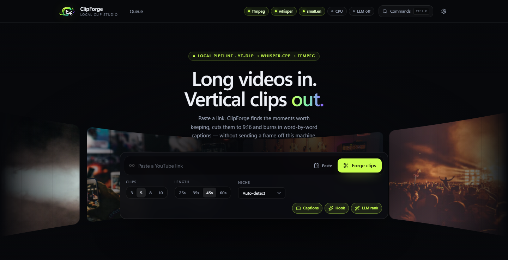

# ClipForge

**Long videos in. Trend-scored vertical clips out — entirely on your machine.**

Paste a YouTube link (or a local file) and ClipForge downloads it, transcribes it with
`whisper.cpp`, scores every moment against short-form hook patterns, then renders 1080×1920
clips with word-by-word karaoke captions, a hook header, and ready-to-post captions/hashtags.

No paid APIs. No uploads. No accounts.



```
yt-dlp → whisper.cpp (local ASR) → trend scorer (+ optional Ollama) → ffmpeg/libass → React UI
```


---

## Features

- **One paste, zero clicks** — download → transcribe → score → cut → caption runs as a background job with live progress.
- **Trend-aware moment detection** — hook, emotion, curiosity, numbers, audio energy, pacing, structure and niche fit. Editable in `trends.json`.
- **Word-level captions** — karaoke-style ASS subtitles burned by ffmpeg/libass, with two-row wrapping.
- **9:16 reframing** — crops landscape footage, or blurs the source behind a centred vertical frame.
- **Optional local LLM** — if [Ollama](https://ollama.com) is running, it re-ranks the shortlist and rewrites titles, hooks and captions. Falls back to heuristics silently.
- **Everything inspectable** — per-job run log, stage timeline, score + reason per clip, transcript in the job payload.
- **Settings that stick** — model, device, workers, keep-source, Ollama on/off.
- **Two UIs** — the React app in `web/`, plus a dependency-free fallback in `static/`.

## Requirements

| | |
|---|---|
| OS | Windows 10/11 (the installer fetches Windows binaries) |
| Python | 3.10+ |
| Node.js | 20+ (only needed for the React UI) |
| Disk | ~700 MB for ffmpeg + whisper.cpp + the `small.en` model |
| GPU | optional — CUDA whisper build for NVIDIA cards |

## Quick start

```powershell
git clone https://github.com/sahillll31/clipping-agent.git
cd clipping-agent

# one-time install: ffmpeg, whisper.cpp (CPU), small.en model, python deps
.\setup.ps1

# start the app
.\run.ps1
# open http://127.0.0.1:8765
```

`setup.ps1` is safe to re-run: it skips anything already installed.

### GPU transcription

```powershell
.\setup.ps1 -Cuda
```

The CUDA build is only kept if it actually runs; otherwise the CPU build stays.

### Smaller / faster model

```powershell
.\setup.ps1 -Model base.en
```

Models: `base.en`, `small.en`, `small`, `medium`, … (anything on the whisper.cpp Hugging Face repo).

## Using it

1. Paste a YouTube URL into the hero input.
2. Pick the number of clips, target length, and optionally a niche.
3. Toggle captions, hook header, and LLM ranking.
4. Hit **Forge clips** and watch the queue.

Each finished clip can be previewed, downloaded as `.mp4`, or copied as a caption + hashtags.
Jobs are deletable from the UI (this removes their files from disk).

## How it works

| Stage | Engine | What happens |
|---|---|---|
| Download | yt-dlp | Best mp4 ≤ 1080p, merged and normalised; local files are imported too |
| Extract | ffmpeg | 16 kHz mono wav |
| Transcribe | whisper.cpp | Local GGML model, word-level timing, CUDA when available |
| Rank | heuristic scorer | Scores candidate windows 0–100 (see below) |
| Rank (optional) | Ollama | Re-ranks the shortlist and rewrites copy |
| Render | ffmpeg + libass | 9:16 crop/blur, karaoke captions, hook header, JPEG thumbnail |
| Export | FastAPI | Preview + one-click download |

### Trend scoring

Every candidate window is scored on:

- **Hook** — questions, imperatives, numbers, contrarian openers, `trends.json` patterns
- **Emotion** — viral keyword density
- **Curiosity** — "but / turns out / here's why" style gaps
- **Energy** — RMS loudness envelope from the wav, plus a dead-air penalty
- **Pacing** — words/sec inside the retention sweet spot
- **Structure** — complete sentences; starting mid-sentence is penalised
- **Niche fit** — matches the detected or requested topic

Overlapping windows are removed greedily. Edit `trends.json` to teach it your own hooks,
keywords, CTAs and niche hashtags — no code changes needed.

### Optional: local LLM ranking

```powershell
ollama pull qwen2.5:3b
```

ClipForge auto-detects Ollama (`/api/tags`) and asks it to re-rank moments and rewrite
titles/hooks/captions. If Ollama is missing or slow, the heuristic ranker takes over.

## Web UI

The React app lives in `web/` (React 19, Vite, Tailwind v4, shadcn-style primitives).

```powershell
cd web
npm install
npm run dev      # http://localhost:5173, proxies /api and /media to :8765
npm run build    # writes web/dist; the FastAPI server serves it automatically
```

`run.ps1` builds `web/dist` on first launch when npm is available, then falls back to the
legacy `static/` UI if no build exists.

## CLI (headless)

```powershell
.\.venv\Scripts\python.exe cli.py "https://youtu.be/..." --clips 5 --length 45
```

Local files work too:

```powershell
.\.venv\Scripts\python.exe cli.py "C:\videos\talk.mp4" --clips 3
```

## API

```
GET      /api/health              toolchain + GPU + LLM status
GET      /api/jobs                list jobs (newest first)
POST     /api/jobs                {url, clip_count, target_length, niche, captions, hook_header, llm}
GET      /api/jobs/{id}
POST     /api/jobs/{id}/cancel
DELETE   /api/jobs/{id}
GET      /api/trends
GET/POST /api/config              models, device, workers, LLM
GET      /media/{id}/clips/clip_01.mp4[?download=1]
```

Interactive docs: <http://127.0.0.1:8765/docs>

## Project layout

```
.
├── server.py          FastAPI app, job API, media serving, worker thread
├── pipeline.py        orchestration + progress reporting
├── downloader.py      yt-dlp wrapper + local-file import
├── transcribe.py      whisper.cpp wrapper (word timings)
├── moments.py         trend scoring + optional Ollama refinement
├── render.py          ASS caption builder + ffmpeg vertical render
├── store.py           JSON job store (data/jobs.json)
├── tools.py           process/ffprobe helpers
├── bootstrap.py       one-shot toolchain installer
├── cli.py             headless runner
├── trends.json        editable trend profile, niches, hashtags
├── static/            dependency-free fallback UI
├── web/               React + Vite + Tailwind UI
│   ├── src/components/ui/   shadcn-style primitives
│   └── public/brand/        ClipForge logo assets
├── assets/fonts/      caption fonts, copied from the OS at setup (git-ignored)
└── data/jobs/<id>/    rendered clips + thumbnails (git-ignored)
```

## Notes & limits

- **YouTube bot checks** — if YouTube asks for verification, export cookies and point yt-dlp at them.
- **CPU speed** — `small.en` on a 20-minute video is roughly real-time to 2× real-time. Use `base.en`
  in Settings, or the CUDA build, for faster turnaround.
- **Music-only sources** — whisper can hallucinate tokens like `[MUSIC]` when there is no speech.
  Treat captions on instrumental videos as unreliable.
- **Storage** — clips are rendered at CRF 20 / veryfast; a 45 s 1080×1920 clip is ~10–20 MB.
- **Fonts** — `Arial Bold` and `Impact` are copied from your Windows install by `setup.ps1` and are
  not redistributed with this repository. Without them libass falls back to system fonts.
- Only download and republish content you have the rights to use.
